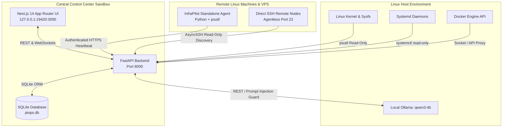

# InfraPilot AI — System Architecture & Technical Design

## 1. High-Level Architecture

InfraPilot AI is architected as a decoupled, privacy-first infrastructure intelligence platform designed for Linux servers, remote clusters, and Pi Network SoloHost nodes.

## 2. Dual Operational Modes

### Mode A: SoloHost Control Center
- Operates inside the sandboxed SoloHost container runtime.
- Complies strictly with the SoloHost Publishing Contract (no `privileged: true`, no host network mode, no root host bind mounts).
- Surfaces primary UI on loopback `127.0.0.1:19420:3000`.
- Collects container-level health, internal metrics, and coordinates external agents.

### Mode B: Standalone Linux Monitoring Agent
- Runs on physical Ubuntu or Debian servers with minimal non-root privileges.
- Collects authorized CPU, memory, partition, and network rate telemetry.
- Transmits data securely to the central control center using hashed token authentication.
- Never accepts arbitrary shell commands from the central server.

## 3. Database Schema

- **SystemSnapshot**: CPU, RAM, Disk, Network I/O, Uptime, Load Averages.
- **ProcessSnapshot**: PID, Process name, CPU %, Memory RSS, Status, User.
- **ServiceSnapshot**: Systemd unit name, load state, active state, description.
- **ContainerSnapshot**: Container ID, name, image, status, health, restart counts.
- **SecurityFinding**: Unique finding ID, severity, category, evidence, explanation, recommended fix.
- **DiagnosticReport**: Performance headroom, bottlenecks, capacity recommendations.
- **ApprovedAction**: Action ID, command preview, risk level, execution logs, approval timestamp.
- **RegisteredAgent**: Agent ID, hostname, IP address, auth token hash, heartbeat status.

## 4. Security & Defensive Model

1. **Deterministic Action Templates**: The Safe Action Engine uses fixed argument lists and `shell=False` execution. It rejects targets containing shell metacharacters (`;`, `&`, `|`, `` ` ``, `$`).
2. **Explicit Operator Approval**: State-changing operations (restarting containers or clearing caches) require explicit manual confirmation. The AI assistant cannot approve operations.
3. **Prompt Injection Protection**: Real system logs and user queries are sanitized of control characters and length-constrained before being passed to Ollama.
4. **Fallback Resilience**: When Ollama is offline or busy, the system falls back to rule-based deterministic diagnostic reasoning.
